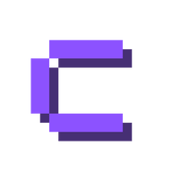
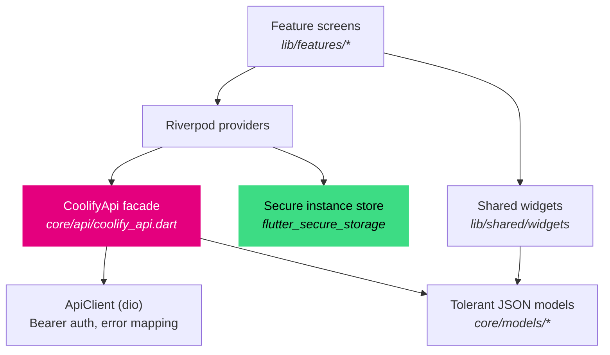

<p align="center">
  
</p>

<h1 align="center">Coolify Mobile</h1>

<p align="center">
  A native Android client for <a href="https://coolify.io">Coolify</a> — the open-source, self-hosted PaaS.
  <br>
  Drive deployments, inspect logs, and manage infrastructure from your pocket.
</p>

<p align="center">
  <a href="LICENSE"></a>
  
  
  
  
</p>

<p align="center">
  <a href="#features">Features</a> ·
  <a href="#quick-start">Quick start</a> ·
  <a href="#configuration">Configuration</a> ·
  <a href="#architecture">Architecture</a> ·
  <a href="#known-limitations">Limitations</a> ·
  <a href="#contributing">Contributing</a>
</p>

---

## Why another client

Coolify's web dashboard is built for a desktop at a desk. This app targets the moments a phone is actually
better for: *did the deploy I just triggered land?*, *what is this container printing right now?*,
*is the box healthy?*

It is a thin, honest client over the **public Coolify v1 API** — no agents, no database of its own, no
tunnel. Point it at your instance, paste a token, and it talks to the same REST API the dashboard does.

**Your token never leaves the device in plaintext.** Instance URLs and tokens live in Android's encrypted
keystore via `flutter_secure_storage`.

---

## Features

| Area | What you can do |
| --- | --- |
| **Instances** | Save several Coolify connections and switch between them; validate a connection (team + version) on save |
| **Dashboard** | Resource counts by type, per-status breakdown, live open deployments, quick actions |
| **Applications** | Deploy (normal / force rebuild), cancel, start / stop / restart, env vars, storages, rollback to a previous image, PR previews |
| **Configuration** | Edit domains, build pack, base/publish dirs, install & start commands, exposed ports, full healthcheck group, Dockerfile location, Compose location & content |
| **Create** | Spin up an app from any connected **GitHub repository** (with live branch picker), or a **one-click service** from a 359-template catalogue |
| **Deployments** | Live deployment feed, per-deployment detail, build output with a full log viewer, cancel in flight |
| **Databases** | Start / stop / restart, env keys, logs, backup schedules (add / run / delete) with execution history |
| **Services** | Container stack overview, per-service app & database components, env keys, logs, docker-compose editor |
| **Servers** | Reachability, resource inventory, hosted domains, proxy validate / restart, Docker image & volume cleanup |
| **Projects** | Browse resources grouped by project and by environment |
| **Tags** | Create / rename / delete tags and attach or detach them from resources |
| **Log viewer** | Go-to-last-line, auto-tail, last *N* lines, timestamp toggle, search with match highlighting, line numbers, wrap, font size, copy all |
| **Settings** | Team info, team members and roles, Coolify version, audit log |

---

## Quick start

### 1. Enable the API on your instance

Self-hosted instances ship with the API **disabled**, and every request returns `403 Forbidden` until you
turn it on:

`https://your-instance` &rarr; **Settings** &rarr; **Advanced** &rarr; **API and MCP** &rarr; set
**API access** to *Enabled*, then **Save changes**.

Optionally fill in **Allowed API IPs** with your client's public outbound address (exact IPs or CIDR
networks, comma-separated). Leaving it empty allows any source address — reasonable on a private network,
restrictive is better in production.

> Behind NAT, allowlist your **public outbound** address, not the private one on your LAN.

### 2. Create a token

1. Log in to your Coolify instance
2. Go to **Settings &rarr; API Tokens**
3. Create a token with the abilities you need:

| Ability | Unlocks |
| --- | --- |
| `read` | Inventory, status, and everything below minus the sensitive extras |
| `write` | Config edits, env vars, backups, tags, project & task CRUD |
| `deploy` | Start / stop / restart, triggering and cancelling deployments |
| `read:sensitive` | Container logs, scheduled-task command bodies, backup execution messages, Compose content |
| `root` | Bypasses the `read` / `write` / `deploy` checks — rarely what you want |

**Grant the least privilege that works.** Two gotchas worth knowing:

- Log endpoints need `read:sensitive`, not plain `read` — without it you get HTTP 403 and the app says so
  rather than failing silently.
- Creating a resource with **Deploy immediately** ticked requires `deploy` *in addition to* its creation
  permission. Tick it off if you only want to stage resources.

&gt; `read:sensitive`, `write`, `deploy`, and `root` all require the token owner to still be a team
> administrator or owner at request time.

### 3. Build and run

```bash
git clone https://github.com/essopsp/coolify-mobile.git
cd coolify-mobile
flutter pub get
flutter run
```

On first launch choose **Add instance**, enter your instance URL (e.g. `https://coolify.example.com`)
and paste the token. The connection is validated before it is saved.

### 4. Release APK

```bash
flutter build apk --release
# build/app/outputs/flutter-apk/app-release.apk
```

> The Flutter template signs release builds with the **debug key**. For distribution, configure your own
> signing config in `android/app/build.gradle.kts` — see the
> [Flutter signing docs](https://docs.flutter.dev/deployment/android#signing-the-app).

---

## Configuration

Everything the app reads or writes is a documented field on the Coolify v1 API. There is no app-specific
configuration file, no feature flag store, and nothing to migrate.

| Setting | Where it comes from |
| --- | --- |
| Instance URL | Stored per instance; the app appends `/api/v1` itself |
| API token | Generated in Coolify, stored in the Android encrypted keystore |
| Theme | Coolify-branded Material 3 dark, derived from the Coolify magenta seed |
| Network | Cleartext HTTP is permitted so plain-HTTP instances on a LAN or VPN work |

**Permissions requested:** `INTERNET` and `ACCESS_NETWORK_STATE`. Nothing else — no storage, camera,
location, or contacts.

### A note on rate limits

Coolify applies per-token rate limits and returns them in response headers. The app fetches on demand and
invalidates cached providers after writes, so normal browsing makes a handful of calls per screen — but if
you script this API, read Coolify's [rate-limit docs](https://coolify.io/docs/api/rate-limits) first.

---

## Architecture

A conventional layered Flutter app. Every Coolify endpoint lives behind one typed facade, so screens never
build URLs and models never touch `dio`.



### Design decisions worth knowing

**One facade, many endpoints.** `CoolifyApi` exposes ~70 typed methods. Screens call
`api.logs('application', uuid)` or `api.patchApplication(uuid, config)` — never a hand-written path.
Adding an endpoint is a one-line change in one file.

**Models are deliberately tolerant.** Every field is parsed through coercion helpers (`jsonStr`, `jsonInt`,
`jsonBool`) that ignore unknown keys and survive type drift. Coolify's API shape changes frequently, and a
tolerant parser keeps the app working when a field is renamed or returns an unexpected type.

**Write and read names differ, and the app bridges them.** Coolify returns `dockerfile_location` and `fqdn`
but accepts `dockerfile` and `domains` on write; Compose domains travel as a newline-delimited textarea but
must be sent as a JSON array. That mapping lives in `AppConfig` / `ServiceConfig` and is covered by tests,
so it cannot silently regress.

**One form per resource type, reused everywhere.** The same build-pack-aware `ConfigForm` edits an
application both while creating it and while patching an existing one; `ServiceConfigForm` does the same
for services. Two forms instead of four — they cannot drift apart.

**Log providers are keyed by their options.** `lines` and `show_timestamps` are part of the provider's
identity, so changing "last 500 lines" in the UI refetches instead of re-filtering stale data.

### Project layout

```
lib/
├── core/
│   ├── api/            # dio client, Coolify v1 facade, error kinds
│   ├── models/         # tolerant JSON models + config value objects
│   ├── providers.dart  # instance store, active instance, api providers
│   ├── router.dart     # go_router route table
│   └── theme.dart
├── features/
│   ├── instances/      # connection management + validation
│   ├── dashboard/      # overview, status breakdown, open deployments
│   ├── resources/      # cross-type resource list
│   ├── applications/   # detail: overview / env / logs / tasks
│   ├── config/         # shared config form + settings screens
│   ├── create/         # GitHub + one-click creation flow
│   ├── deployments/    # live feed + build log viewer
│   ├── databases/      # detail incl. backup schedules
│   ├── services/       # multi-container stacks
│   ├── servers/        # inventory, domains, maintenance
│   ├── projects/       # projects + environments
│   ├── tags/           # tag browsing
│   └── settings/       # team, members, audit
└── shared/widgets/     # async view, log viewer, status chip, dialogs
```

---

## Known limitations

Honest list, so nothing surprises you at runtime:

- **Audit events need a team-owner token.** `GET /audit-events` works with a token owned by a team
  administrator or owner, and only `read:sensitive` or `root` returns the richer fields (actor email, IP,
  user agent, and the before/after change set). Coolify also prunes events after 90 days.
- **Secret env values are never returned** by the API. You can add, edit, and delete variables, but a value
  already marked secret has to be re-entered — this is a Coolify constraint, not an app choice.
- **One-click service logos load from the network.** They are fetched on demand from the upstream Coolify
  repository rather than bundled, which keeps the APK small. With no connectivity those rows show a neutral
  glyph.
- **Android only.** The codebase is platform-agnostic Flutter, but iOS packaging, signing, and store metadata
  are not set up.

---

## Contributing

Contributions are very welcome — this is a small codebase and the maintainer is reachable.

1. Fork the repository
2. Create a branch (`git checkout -b feat/your-feature`)
3. Keep it green:

```bash
flutter analyze   # must report "No issues found!"
flutter test      # must pass
```

4. Open a pull request

A few conventions the codebase follows, so a patch stays easy to review:

- Route all API calls through `CoolifyApi`; do not construct URLs in widgets
- Add a test for any new value-object mapping — that is where bugs hide
- Prefer updating an existing screen over adding a parallel one

---

## Disclaimer

An independent, community client. Not affiliated with, endorsed by, or supported by the Coolify team.

## License

[MIT](LICENSE) — see the [LICENSE](LICENSE) file.